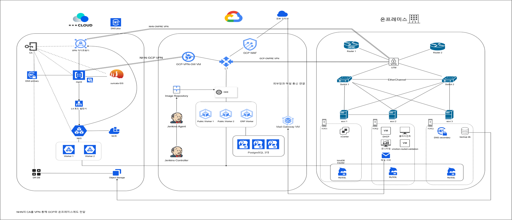
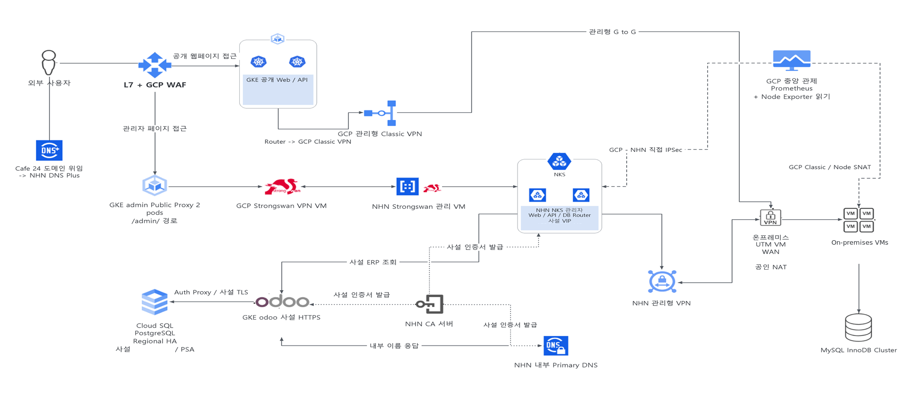

# 김규현 | 보안·인프라·네트워크 엔지니어를 준비합니다

웹 서비스를 개발하고, 서비스가 연결되는 서버·네트워크 환경을 실습하며 보안·인프라 분야 취업을 준비하고 있습니다.

## 프로젝트

### 대피할지도 — 재난 대피소 지도 서비스 · 1차 팀 프로젝트

재난 유형별 대피소를 지도에서 찾고, 현재 지도 영역과 위치를 기준으로 정보를 확인하는 웹 서비스

- **전체 구성:** 지도·대피소 조회 Service / 회원·대피소·게시판 관리 Admin / 데이터 처리용 Docker Host
- **개인 참여 범위:** Service 개발 전담, Docker Host 구성·DB 연결·Python 작업 컨테이너·호스트 Cron 예약 실행
- **사용 기술:** Java·Spring Boot·Spring Data JPA·MySQL·HTML/CSS·JavaScript·Thymeleaf·Kakao Maps API / Ubuntu·Docker·Python·Cron

[프로젝트 전체 기록](https://road-bloom-792.notion.site/1-3e110d3ee8d380f89984c41d0ea02594) · [Service 코드·구현 설명](https://github.com/kyu0318/service) · [인프라 구축 기록](https://road-bloom-792.notion.site/1-Docker-Host-3c910d3ee8d380e780f7c6db82d112a8) · [Admin 코드](https://github.com/kyu0318/admin-main) · [Admin 원본](https://github.com/ehdgus4026-tech/admin)

### 멀티·하이브리드 클라우드 인프라 구축 · 2차 팀 프로젝트

식품 유통 기업의 서비스 확장을 가정한 온프레미스·GCP·NHN Cloud 연동 프로젝트 (4인 · 2026.10.19~2026.11.15 · 구축 완료)

- **전체 구성** · GCP(GKE) 고객용 웹·API 및 ERP / NHN Cloud(NKS) 관리자 웹·API / 온프레미스 업무용 MySQL DB. Site-to-Site IPsec VPN으로 세 거점 연결
- **내 역할** · PM으로 일정과 거점 간 연동 순서 조율. 온프레미스 ESXi·vCenter 가상화 및 CephFS 공유 스토리지 구성, Sophos UTM 방화벽·IPS 정책 설정, Promiscuous Mode 기반 Suricata IDS 트래픽 수집 환경 구성
- **운영·검증** · mysqld_exporter·Prometheus로 MySQL 지표 수집 및 Grafana 시각화, MySQL InnoDB Cluster 장애 전환 후 서비스 재연결 검증 참여

**전체 인프라 구성도**

사용자·관리자 요청 및 거점 간 통신 흐름도

*공개용 구성도의 접속 IP·도메인 가림.*

[Notion 포트폴리오 · 2차 프로젝트](https://road-bloom-792.notion.site/40410d3ee8d3810a92cbc42c2bf94ee6)

## 기술스택

프로젝트·교육 실습의 사용 기술과 관련 학습 기록. 상세 버전·구현 범위는 각 저장소와 문서 기준

| 구분 | 기술 | 사용·학습 범위 |
| --- | --- | --- |
| Application & Data | Java 17, Spring Boot 4.1.0, Spring MVC, Spring Data JPA, Hibernate, MySQL, Maven | 1차 프로젝트 Service API·엔티티·조회 처리, 빌드 설정 |
| Frontend | HTML, CSS, JavaScript, Thymeleaf, Kakao Maps API | 사용자 화면, 지도·마커·장소 검색, 대피소 목록 연동 |
| Infrastructure | Ubuntu, Docker, Python, Cron | Docker Host 구성, DB 연결, 데이터 처리 컨테이너·호스트 Cron 예약 작업 설정 기록 |
| Network & Virtualization | VMware, VyOS, Rocky Linux, Windows, DNS·DHCP, VPN, Active Directory | 가상 환경의 네트워크·서버·접근 권한 설정 실습 |
| Cloud · 학습 기록 | AWS VPC·EC2·ALB 등 | AWS 복합 실습 문서의 구성 절차·학습 기록 |
| Hybrid Cloud | GCP(GKE), NHN Cloud(NKS), VMware ESXi·vCenter, CephFS | 2차 프로젝트의 서비스 배치 및 온프레미스 가상화·공유 스토리지 구성 |
| Network Security | Site-to-Site IPsec VPN, VLAN, Sophos UTM, Suricata IDS | 거점 연결, VLAN별 방화벽·IPS 정책, IDS 트래픽 수집 환경 구성 |
| Monitoring & Availability | MySQL InnoDB Cluster, mysqld_exporter, Prometheus, Grafana | MySQL 지표 수집·시각화 및 장애 전환 후 서비스 재연결 검증 |
| Tools | Git, GitHub | 소스·문서 버전 관리 |

Spring Boot 버전은 저장소 POM 선언 기준. 빌드·실행 성공 여부는 별도 검증 필요

## 관련 실습·문서

- [포트폴리오 허브](https://road-bloom-792.notion.site/40410d3ee8d3810a92cbc42c2bf94ee6): 프로젝트·실습·학습 기록의 통합 진입점
- [인프라 실습 기록](https://road-bloom-792.notion.site/3e110d3ee8d38062a09bea4b5cec09b6): 네트워크·서버·접근 권한 설정 실습
- [인프라 학습 정리](https://road-bloom-792.notion.site/3e110d3ee8d38038b8c8faeef5b351e3): 개념·작동 흐름·면접 대비 정리

프로젝트 구현, 교육 실습, 학습 기록을 구분해 정리
